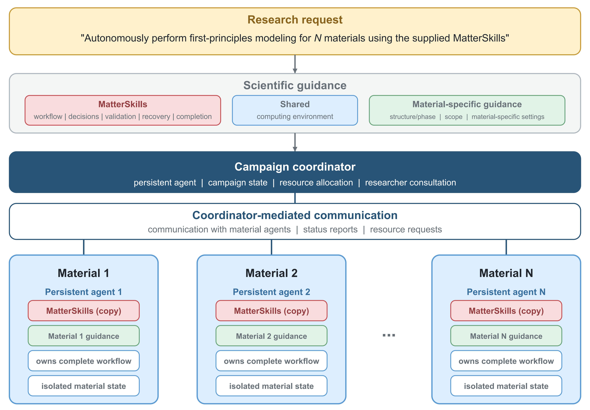

# AgenticMM

AgenticMM is a material-centered multi-agent architecture for scalable first-principles materials modeling. One persistent agent owns each material's workflow and scientific state, and one coordinator manages shared computing resources, communication, and campaign progress. Externally supplied MatterSkills define the scientific workflows.

This repository accompanies *AgenticMM: A Material-Centered Multi-Agent Architecture for Scalable First-Principles Materials Modeling* by Zhenkun Yuan and Geoffroy Hautier.

## Repository contents

- [AgenticMM.pdf](AgenticMM.pdf) contains an introduction and the architecture and execution protocol (Sections II and III).
- [AgenticMM.tex](AgenticMM.tex) is the LaTeX source.
- [figures/](figures/) contains the architecture diagram.

## How to use

1. Start a campaign in an agent runtime that can instantiate one coordinator and one agent per material.
2. Supply [AgenticMM.pdf](AgenticMM.pdf) and the MatterSkills for your workflow. For VASP-based point-defect calculations, use [DefectSkills](https://github.com/zy75-prog/DefectSkills).
3. Provide the materials, campaign objective, authorized computing environment, and material-specific requirements. Follow the readiness checks in Section III before launching any calculations.
4. Confirm the campaign setup and verify the recorded agent assignments before authorizing execution.

## License

The documentation and architecture figure in this repository are licensed under CC BY 4.0. See [LICENSE.md](LICENSE.md) for the scope and attribution.
